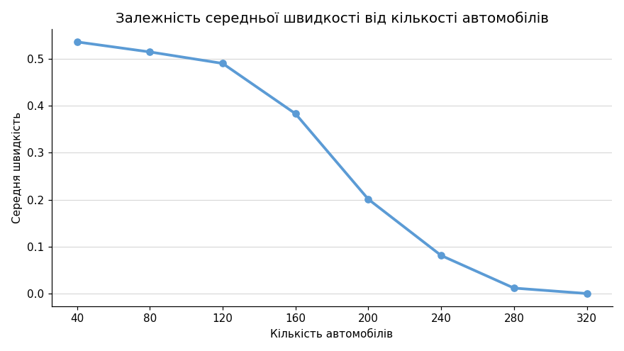
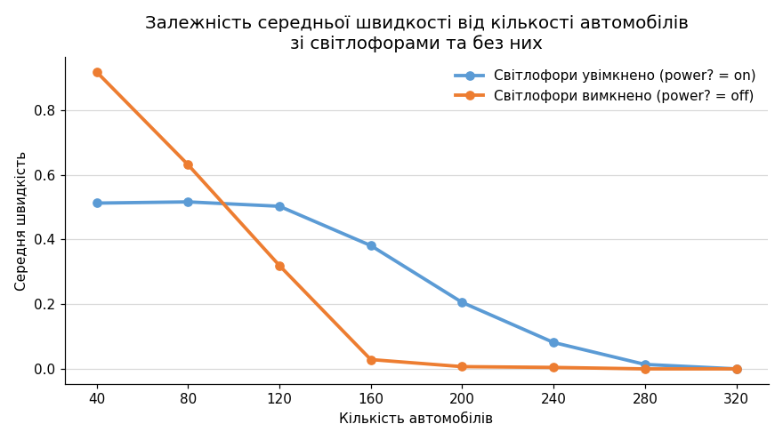
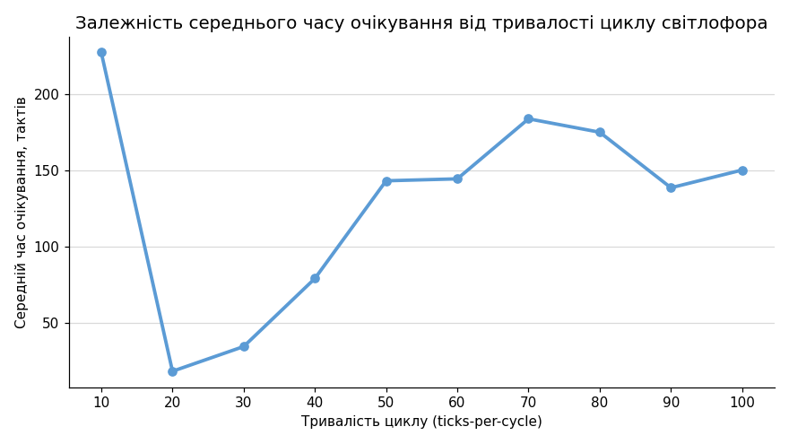

## Комп'ютерні системи імітаційного моделювання
## СПм-25-1, Батурін Олексій Олександарович
### Лабораторна робота №1. Опис імітаційних моделей та проведення обчислювальних експериментів

 

### Варіант 1, модель у середовищі NetLogo:
[Traffic Grid](http://www.netlogoweb.org/launch#http://www.netlogoweb.org/assets/modelslib/Sample%20Models/Social%20Science/Traffic%20Grid.nlogo)

 

### Вербальний опис моделі:
Модель імітує рух автомобілів міською мережею доріг у вигляді прямокутної сітки, на перетинах якої розташовані перехрестя зі світлофорами. Кожен автомобіль є агентом, що рухається або горизонтально (праворуч), або вертикально (донизу); при виїзді за межу світу автомобіль з'являється з протилежного боку, тобто мережа доріг замкнена.

На кожному такті автомобіль:
- зупиняється, якщо перед ним перехрестя з червоним для його напрямку світлом;
- гальмує, якщо безпосередньо попереду знаходиться інший автомобіль;
- прискорюється (до обмеження (speed-limit)), якщо попереду вільно.

Якщо автомобіль стоїть, його лічильник очікування (wait-time) зростає, а при русі скидається. Світлофори перемикаються автоматично через певну кількість тактів (ticks-per-cycle) з урахуванням фази кожного перехрестя; також можна вимкнути світлофори зовсім або керувати обраним перехрестям вручну. Модель дозволяє дослідити, як щільність руху та налаштування світлофорів впливають на утворення заторів.

### Керуючі параметри:
- **grid-size-x**, **grid-size-y**: кількість вертикальних та горизонтальних доріг, тобто розмір мережі доріг і кількість перехресть.
- **num-cars**: кількість автомобілів у моделі. Не може перевищувати кількість клітинок доріг.
- **speed-limit**: максимальна швидкість, яку може мати автомобіль.
- **ticks-per-cycle**: тривалість циклу світлофора, тобто через скільки тактів світлофори перемикаються.
- **current-phase**: фаза (у відсотках від циклу) обраного перехрестя, тобто зсув моменту його перемикання відносно інших.
- **power?**: вмикає або вимикає світлофори. Без світлофорів автомобілі проїжджають перехрестя без зупинки.
- **current-auto?**: чи перемикається обраний світлофор автоматично; при вимкненні ним керують вручну кнопкою *Change light*.

### Внутрішні параметри:
- **speed**: поточна швидкість автомобіля. Змінюється на кожному такті в межах від 0 до speed-limit.
- **up-car?**: напрямок руху автомобіля (true: рухається донизу вертикальною дорогою, false: праворуч горизонтальною).
- **wait-time**: кількість тактів, протягом яких автомобіль стоїть без руху.
- **acceleration**: константа, на яку автомобіль збільшує або зменшує швидкість за один такт. Спільна для всіх агентів.

### Показники роботи системи:
- **Stopped Cars**: кількість автомобілів, що стоять на поточному такті.
- **Average Speed of Cars**: середня швидкість усіх автомобілів.
- **Average Wait Time of Cars**: середній час очікування автомобілів.

### Примітки:
Початкове розміщення автомобілів випадкове, тому результати окремих запусків з однаковими параметрами можуть відрізнятися; для експериментів доцільно усереднювати кілька запусків.

### Недоліки моделі:
- Автомобілі рухаються лише в одному напрямку на кожній дорозі та не повертають на перехрестях.
- Автомобіль реагує лише на перешкоду безпосередньо перед собою, тому гальмування різке, а не поступове.
- Світлофори не враховують завантаженість доріг (немає «розумного» регулювання).

 

## Обчислювальні експерименти
### 1. Вплив кількості автомобілів на середню швидкість руху
Досліджується залежність середньої швидкості всіх автомобілів на 500-му такті симуляції від кількості автомобілів у мережі доріг (**num-cars**).
Експерименти проводяться при кількості автомобілів від 40 до 320 з кроком 40, усього 8 значень параметру. Для кожного значення виконано 10 запусків, результати усереднені. Експерименти проводились за допомогою інструменту BehaviorSpace.

Інші керуючі параметри мають значення за замовчуванням:
- **grid-size-x**: 5
- **grid-size-y**: 5
- **speed-limit**: 1
- **ticks-per-cycle**: 20
- **current-phase**: 0
- **power?**: on
- **current-auto?**: on

<table>
<thead>
<tr><th>Кількість автомобілів</th><th>Середня швидкість</th></tr>
</thead>
<tbody>
<tr><td>40</td><td>0,536</td></tr>
<tr><td>80</td><td>0,515</td></tr>
<tr><td>120</td><td>0,490</td></tr>
<tr><td>160</td><td>0,383</td></tr>
<tr><td>200</td><td>0,201</td></tr>
<tr><td>240</td><td>0,081</td></tr>
<tr><td>280</td><td>0,012</td></tr>
<tr><td>320</td><td>0,000</td></tr>
</tbody>
</table>

Середня швидкість практично не змінюється до 120 автомобілів (≈0,5), далі різко падає, а при 280 і більше автомобілях мережа доріг повністю блокується, а швидкість наближається до нуля. Критичне завантаження становить від 160 до 200 автомобілів, тобто приблизно половину клітинок доріг. Навіть при малій кількості автомобілів швидкість удвічі нижча за speed-limit, оскільки рух обмежують світлофори, а не інші автомобілі.

### 2. Вплив світлофорів на середню швидкість при різному завантаженні доріг
Досліджується, чи покращують світлофори рух автомобілів. Порівнюється середня швидкість усіх автомобілів на 500-му такті при увімкнених та вимкнених світлофорах (**power?**) для різної кількості автомобілів (**num-cars** від 40 до 320 з кроком 40). Для кожної комбінації параметрів виконано 10 запусків, результати усереднені (усього 160 запусків у BehaviorSpace).

Інші керуючі параметри мають значення за замовчуванням:
- **grid-size-x**: 5
- **grid-size-y**: 5
- **speed-limit**: 1
- **ticks-per-cycle**: 20
- **current-phase**: 0
- **current-auto?**: on

<table>
<thead>
<tr><th>Кількість автомобілів</th><th>Середня швидкість (світлофори увімкнено)</th><th>Середня швидкість (світлофори вимкнено)</th></tr>
</thead>
<tbody>
<tr><td>40</td><td>0,513</td><td>0,918</td></tr>
<tr><td>80</td><td>0,516</td><td>0,632</td></tr>
<tr><td>120</td><td>0,503</td><td>0,320</td></tr>
<tr><td>160</td><td>0,381</td><td>0,029</td></tr>
<tr><td>200</td><td>0,206</td><td>0,007</td></tr>
<tr><td>240</td><td>0,082</td><td>0,005</td></tr>
<tr><td>280</td><td>0,014</td><td>0,000</td></tr>
<tr><td>320</td><td>0,000</td><td>0,000</td></tr>
</tbody>
</table>

Результат неочевидний. При малому завантаженні (до 80 автомобілів) без світлофорів рух помітно швидший: при 40 автомобілях середня швидкість 0,92 проти 0,51, оскільки автомобілі не зупиняються на червоне світло. Проте вже при 120 автомобілях ситуація змінюється на протилежну, а від 160 автомобілів мережа доріг без світлофорів практично повністю блокується (швидкість близька до нуля), тоді як зі світлофорами рух ще зберігається. Причина в тому, що без світлофорів автомобілі виїжджають на перехрестя одночасно з двох напрямків і перекривають один одному шлях, утворюючи взаємне блокування. Отже, світлофори знижують швидкість при вільних дорогах, але запобігають заторам при значному завантаженні. Точка, в якій світлофори стають вигідними, знаходиться приблизно між 80 та 120 автомобілями.

### 3. Пошук оптимальної тривалості циклу світлофора
Досліджується залежність середнього часу очікування автомобілів на 500-му такті від тривалості циклу світлофора (**ticks-per-cycle**). Значення параметру змінюється від 10 до 100 з кроком 10, усього 10 значень. Для кожного значення виконано 10 запусків, результати усереднені. Додатково фіксувалась середня швидкість.

Інші керуючі параметри:
- **num-cars**: 200 (завантаження, близьке до критичного за результатами експерименту 1)
- **grid-size-x**: 5
- **grid-size-y**: 5
- **speed-limit**: 1
- **current-phase**: 0
- **power?**: on
- **current-auto?**: on

<table>
<thead>
<tr><th>Тривалість циклу</th><th>Середній час очікування, тактів</th><th>Середня швидкість</th></tr>
</thead>
<tbody>
<tr><td>10</td><td>227,6</td><td>0,006</td></tr>
<tr><td>20</td><td>18,4</td><td>0,203</td></tr>
<tr><td>30</td><td>34,6</td><td>0,144</td></tr>
<tr><td>40</td><td>79,3</td><td>0,123</td></tr>
<tr><td>50</td><td>143,4</td><td>0,018</td></tr>
<tr><td>60</td><td>144,7</td><td>0,060</td></tr>
<tr><td>70</td><td>184,1</td><td>0,031</td></tr>
<tr><td>80</td><td>175,2</td><td>0,046</td></tr>
<tr><td>90</td><td>138,8</td><td>0,050</td></tr>
<tr><td>100</td><td>150,4</td><td>0,093</td></tr>
</tbody>
</table>

Залежність має чітко виражений мінімум при тривалості циклу 20 тактів (середнє очікування близько 18 тактів, найвища середня швидкість 0,20). При дуже короткому циклі (10 тактів) світлофори перемикаються так часто, що автомобілі не встигають проїхати перехрестя, і мережа блокується: час очікування зростає більш ніж у 10 разів. При довгому циклі (40 тактів і більше) автомобілі довго стоять на червоне світло, черги перед перехрестями розростаються і перекривають сусідні перехрестя, тому час очікування також зростає. Починаючи приблизно з 50 тактів, значення виходять на плато в межах від 140 до 185 тактів, а коливання між сусідніми точками (зокрема зниження при 90 тактах) знаходяться в межах випадкового розкиду: стандартне відхилення між запусками в цій області становить від 60 до 100 тактів. Великий розкид пояснюється тим, що при довгому циклі в одних запусках утворюється повний затор, а в інших ні. Таким чином, значення ticks-per-cycle = 20, встановлене в моделі за замовчуванням, є близьким до оптимального для даного завантаження.
